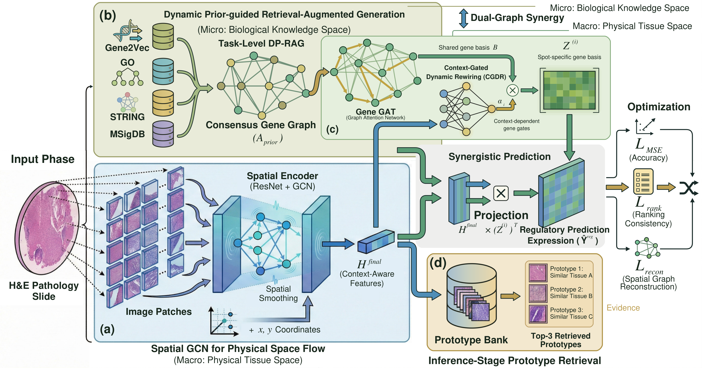
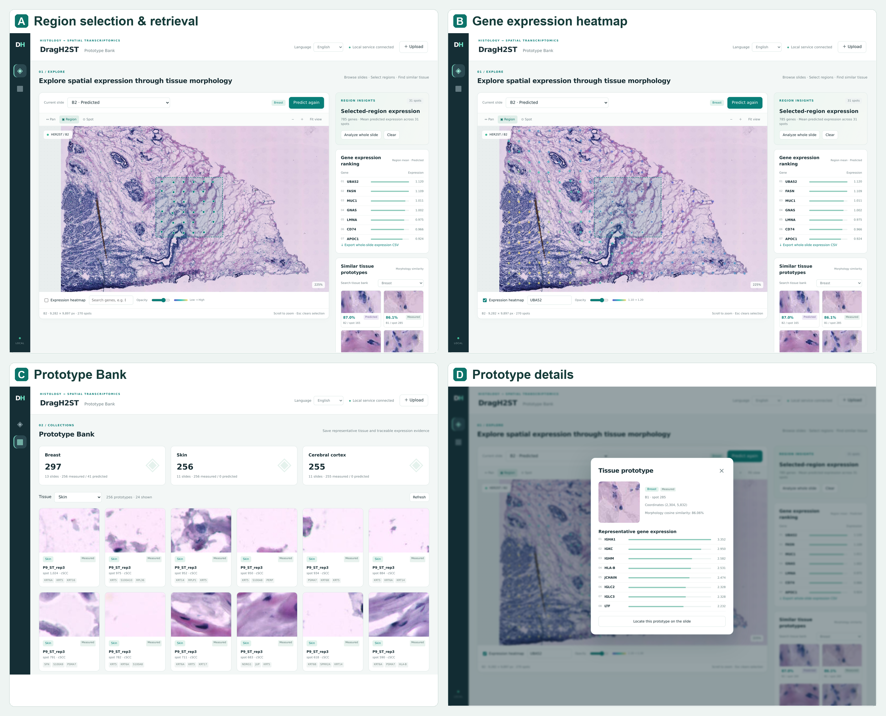

# DragH2ST

[English](README.md) | [简体中文](assets/README.zh-CN.md)

**Dynamic Regulatory Graph Learning for Histology-to-Spatial Transcriptomics**

DragH2ST predicts spatial gene expression from H&E histology images by combining
tissue morphology, spatial context, and biological knowledge. It integrates
multiple knowledge sources into a task-specific gene prior and adapts shared
gene representations to each spot through histology-conditioned gating. Visual
and regulatory predictions are fused to capture spatial expression patterns,
while retrieval of morphologically similar tissue prototypes provides case-based
references for interpretation.



*Figure 1. Overview of DragH2ST.*

## Installation

We recommend running with Python 3.10, PyTorch 2.4.1, and CUDA 12.4 on an NVIDIA GPU.

```bash
python3.10 -m venv .venv
source .venv/bin/activate
python -m pip install --upgrade pip
python -m pip install torch==2.4.1 torchvision==0.19.1 --index-url https://download.pytorch.org/whl/cu124
python -m pip install -r requirements.txt
```

## Configuration and resource locations

**Edit only `config.yaml` to change parameters or paths.** Commands accept an
action only. Relative paths are resolved against the project directory.
The default locations are:

```yaml
paths:
  data: data
  artifacts: artifacts
  resnet_weights: data/weights/resnet50-11ad3fa6.pth
```

| Resource                                 | Location                                 | How it is obtained                                                 |
| ---------------------------------------- | ---------------------------------------- | ------------------------------------------------------------------ |
| Prepared datasets                        | `data/{her2st,cSCC,dlpfc}/`            | Obtain and organize separately                                     |
| Original biological prior resources      | `data/biological_database/`            | Extract the included`data/biological_database.7z` into `data/` |
| ResNet50 ImageNet V2 weights             | `data/weights/resnet50-11ad3fa6.pth`   | Download explicitly using the command below                        |
| ResNet feature caches                    | `artifacts/features/`                  | Generated by`prepare` or `train`                               |
| Fused prior matrices and gene embeddings | `artifacts/priors/`                    | Generated from the local biological resources                      |
| Trained models and evaluation outputs    | `artifacts/runs/<dataset>/fold<fold>/` | Generated by training and evaluation                               |
| Persistent Prototype Bank                | `artifacts/library/prototypes.sqlite3` | Generated by`build-library` and browser additions                |
| Uploads and browser prediction caches    | `artifacts/workspace/`                 | Generated by the Prototype Bank workspace                          |

The package includes `data/biological_database.7z` and directories for datasets
and weights. Extract the biological resources and prepare the datasets and
ResNet weights as described below. Runtime outputs are generated locally.

## Datasets

We evaluate on HER2ST, cSCC, and DLPFC. Their publications and access links are
listed in [Resources and references](#resources-and-references).
The data loaders expect the following layout:

```text
data/
├── biological_database.7z            # Included archive; extract into data/
├── weights/resnet50-11ad3fa6.pth      # Download the official weights separately
├── her_hvg_cut_1000.npy               # Ordered panel: 785 HER2ST genes
├── cSCC_hvg_cut_1000.npy              # Ordered panel: 1000 cSCC genes
├── dlpfc_hvg_cut_1000.npy             # Ordered panel: 1000 DLPFC genes
├── her2st/data/
│   ├── ST-cnts/<slide>.tsv
│   ├── ST-spotfiles/<slide>_selection.tsv
│   └── ST-imgs/<group>/<slide>/<image>
├── cSCC/GSE144239_RAW/
│   ├── *_<slide>_stdata.tsv[.gz]
│   ├── *spot_data-selection-<slide>.tsv[.gz]
│   └── *_<slide>.jpg[.gz]
├── dlpfc/<slide>/
│   ├── <slide>_filtered_feature_bc_matrix.h5
│   ├── tissue_positions_list.txt
│   ├── scalefactors_json.json
│   └── <slide>_full_image.tif
└── biological_database/
    ├── gene2vec_dim_200_iter_9_w2v.txt
    ├── go-basic.obo
    ├── goa_human.gaf
    ├── c2.cp.v2025.1.Hs.symbols.gmt
    └── string/
        ├── 9606.protein.links.v12.0.txt
        ├── 9606.protein.info.v12.0.txt
        └── gene2protein_symbol_to_ensp.tsv
```

`[.gz]` indicates an optional gzip suffix for the cSCC files. The implementation
uses HER2ST A1–A6/B1–B6, cSCC P2/P5/P9/P10 with three replicates each, and the
12 DLPFC slides listed in `drag_h2st/data.py`.

Set `training.dataset` and `training.fold` for the current training run. Fold
indices start at zero. `datasets.folds` selects the model/training split for each
tissue in feature preparation and the Prototype Bank. Keep its entry for the
current dataset aligned with `training.fold` when preparing a different split.

## Biological priors

DP-RAG combines Gene2Vec cosine similarity, MSigDB membership similarity, STRING
interaction/shared-neighbor similarity and GO semantic similarity. All four
resource weights, the fused-similarity threshold and graph Top-K are configured
in `config.yaml`.

The included `data/biological_database.7z` contains the required files from
[Gene2Vec](https://github.com/jingcheng-du/Gene2vec),
[GO and GOA](https://geneontology.org/), [STRING v12](https://string-db.org/)
and the **MSigDB human C2 canonical pathways, 2025.1, gene symbols** collection
from [MSigDB](https://www.gsea-msigdb.org/gsea/msigdb/human/collections.jsp).
The prepared `gene2protein_symbol_to_ensp.tsv` mapping is included as well.
The archive is approximately **82.2 MiB**, containing seven files with a combined
uncompressed size of approximately **885.0 MiB**. From the project root, extract
it with [7-Zip](https://www.7-zip.org/) before running `prepare` or `train`:

```bash
7z x data/biological_database.7z -odata
```

In the 7-Zip graphical interface, select `data/` as the extraction destination.
The archive already contains the `biological_database/` directory, so extraction
produces `data/biological_database/` with the layout above. The loader reads the
extracted files. If `paths.data` is changed, extract into that data directory.

`prepare` builds and caches the fused similarities and gene embeddings in
`artifacts/priors/`. Training also builds a missing prior from the same local
resources. Existing compatible caches are reused.

## ResNet weights

The visual encoder uses the frozen official torchvision **ResNet50 ImageNet V2**
weights. Download the exact file before feature extraction:

```bash
mkdir -p data/weights
curl -fL --retry 3 https://download.pytorch.org/models/resnet50-11ad3fa6.pth -o data/weights/resnet50-11ad3fa6.pth
```

The loader checks that this is the expected official weight file. Set
`paths.resnet_weights` to its location if stored elsewhere. Feature extraction
uses 112 × 112 histology crops resized to 224 × 224 with ImageNet normalization.

## Run

```bash
python run.py prepare       # Features and biological priors for all three datasets
python run.py train         # Train the dataset/fold selected in config.yaml
python run.py evaluate      # Evaluate its saved best checkpoint
python run.py build-library # Build the measured-expression Prototype Bank
python run.py serve         # Start the Prototype Bank browser workspace
python run.py search        # Small local parameter search around the current YAML
```

For the full workspace, run `prepare`, train the desired dataset/fold, run
`build-library`, then start `serve`. To provide all three tissue models, train each
dataset at its configured fold by editing the same YAML between runs. `train`
prepares missing features for its selected split automatically.

The default configuration selects HER2ST fold 0, seed 12000, a maximum of
500 epochs and early stopping with patience 50. Checkpoint selection uses
**HVG50 PCC + HEG50 PCC**; inference loads the best checkpoint. Saved checkpoints
retain the training configuration and ordered gene panel.

All three entries in `datasets.folds` default to 0 as editable examples.

`search` tests ten nearby single-setting candidates and up to three combinations
of beneficial settings, using the normal full training budget. It selects by the
same composite validation score, then all-gene PCC and lower MSE as tie breakers.
It saves experiment records under `artifacts/search`, preserves the baseline,
and installs the selected YAML settings and trained model. The held-out slide
selects checkpoints and parameters, so these scores are validation results;
an independent test split is needed to assess generalization.

## Prototype Bank

Open **http://localhost:8080** after running `python run.py serve`. Configure the
host and port in `config.yaml`; forward port 8080 when accessing a remote server.
All frontend assets are served locally. The language selector supports **English,
French, Spanish and Chinese**, with **English as the first-visit default**. Your
selection is saved in this browser. Interface text, tissue labels, dialogs, task
status, validation messages and number formatting change together; custom tissue
names and scientific identifiers retain their original values.

1. Choose a built-in slide or upload a PNG/JPEG/TIFF with a tissue model. An optional
   CSV provides `pixel_x,pixel_y` and grid `x,y`; otherwise tissue is sampled automatically.
2. Predict expression, zoom/pan the image, and select a rectangle or single spot.
3. Inspect mean expression rankings, gene heatmaps and similar morphology prototypes.
4. Browse prototype images, expression sources and slide locations. Add predicted
   slides to a tissue library or export whole-slide expression as CSV.

Measured banks use representative real spots nearest K-Means centers in normalized
ResNet feature space, with a 256-prototype budget per dataset's training split.
Held-out measured expression is excluded. Browser additions are explicitly marked
as predicted and replace the existing representatives when reindexed. Retrieval
uses cosine similarity and requires the same tissue and exact ordered gene panel.
Prototype expression is shown as evidence and is not blended into model predictions.

[](assets/screenshots/prototype-bank-overview-en.png)

*Prototype Bank workspace: (A) region selection and retrieval, (B) gene expression
heatmap, (C) prototype collections, and (D) prototype details. Click to enlarge.*

## Code structure and method conventions

```text
DragH2ST/
├── LICENSE
├── README.md
├── requirements.txt
├── config.yaml
├── run.py
├── assets/
│   ├── README.zh-CN.md
│   ├── figure1.png
│   └── screenshots/         # Workspace screenshots (English/Chinese)
├── data/
│   ├── biological_database.7z
│   ├── her2st/data/           # Empty dataset directories
│   │   ├── ST-cnts/
│   │   ├── ST-imgs/
│   │   └── ST-spotfiles/
│   ├── cSCC/GSE144239_RAW/
│   ├── dlpfc/
│   └── weights/              # Add the downloaded ResNet weights here
└── drag_h2st/
    ├── config.py
    ├── data.py
    ├── features.py
    ├── attention.py
    ├── spatial_encoder.py
    ├── dp_rag/
    ├── cgdr.py
    ├── model.py
    ├── losses.py
    ├── metrics.py
    ├── pipeline.py
    ├── search.py
    └── prototype_bank/
        ├── bank.py
        ├── workspace.py
        ├── server.py
        ├── messages.py
        └── static/
            ├── index.html
            ├── style.css
            ├── i18n.js
            ├── translations.json
            └── app.js
```

| Paper component               | Code                                                      |
| ----------------------------- | --------------------------------------------------------- |
| Spatial Encoder / Spatial GCN | `features.py`, `spatial_encoder.py`, `attention.py` |
| DP-RAG                        | `dp_rag/`                                               |
| CGDR / Gene GAT               | `cgdr.py`                                               |
| Synergistic Prediction        | `model.py`                                              |
| Optimization objectives       | `losses.py`                                             |
| Prototype Bank                | `prototype_bank/`                                       |

Expression preprocessing uses library-size normalization followed by the actual
`scprep.transform.log` default, **log10(x+1)**. Spatial graphs are directed
four-neighbor graphs with distance ≤2. CGDR applies context gates after a shared
Gene GAT, and prediction uses weighted linear/regulatory fusion, following the
main ResNet implementation. Training resets its seed after feature preparation.

## Acknowledgments

Our work draws inspiration in part from
[Hist2ST (Zeng et al., 2022)](https://doi.org/10.1093/bib/bbac297),
[M2TGLGO (Shi et al., CVPR 2025)](https://doi.org/10.1109/CVPR52734.2025.01938),
and [STRank (Nishimura et al., 2025)](https://arxiv.org/abs/2512.06612).
We thank their authors for sharing their research and resources. We also thank
the ResNet authors, the torchvision maintainers, and the contributors to the
datasets and biological databases used in this work.

## Resources and references

The datasets, biological resources, and visual backbone used in this work are
listed below with their publications and resource links.

| Resource                       | Publication                                                                                                                                                                                                                                                                       | Access                                                                                                                                                                                         |
| ------------------------------ | --------------------------------------------------------------------------------------------------------------------------------------------------------------------------------------------------------------------------------------------------------------------------------- | ---------------------------------------------------------------------------------------------------------------------------------------------------------------------------------------------- |
| ResNet50 / ImageNet V2 weights | [Deep Residual Learning for Image Recognition](https://doi.org/10.1109/CVPR.2016.90), CVPR, 2016                                                                                                                                                                                   | [Download weights](https://download.pytorch.org/models/resnet50-11ad3fa6.pth) / [torchvision documentation](https://pytorch.org/vision/stable/models/generated/torchvision.models.resnet50.html) |
| HER2ST                         | [Spatial deconvolution of HER2-positive breast cancer delineates tumor-associated cell type interactions](https://doi.org/10.1038/s41467-021-26271-2), Nature Communications, 2021                                                                                                 | [Dataset](https://github.com/almaan/her2st)                                                                                                                                                     |
| cSCC                           | [Multimodal Analysis of Composition and Spatial Architecture in Human Squamous Cell Carcinoma](https://doi.org/10.1016/j.cell.2020.05.039), Cell, 2020                                                                                                                             | [GEO: GSE144239](https://www.ncbi.nlm.nih.gov/geo/query/acc.cgi?acc=GSE144239)                                                                                                                  |
| DLPFC                          | [Transcriptome-scale spatial gene expression in the human dorsolateral prefrontal cortex](https://doi.org/10.1038/s41593-020-00787-0), Nature Neuroscience, 2021                                                                                                                   | [spatialLIBD](https://research.libd.org/spatialLIBD/)                                                                                                                                           |
| Gene2Vec                       | [Gene2vec: distributed representation of genes based on co-expression](https://doi.org/10.1186/s12864-018-5370-x), BMC Genomics, 2019                                                                                                                                              | [Gene2Vec resources](https://github.com/jingcheng-du/Gene2vec)                                                                                                                                  |
| GO / GOA                       | [The Gene Ontology knowledgebase in 2023](https://doi.org/10.1093/genetics/iyad031), Genetics, 2023                                                                                                                                                                                | [Gene Ontology](https://geneontology.org/) / [GOA](https://www.ebi.ac.uk/GOA)                                                                                                                    |
| STRING v12                     | [The STRING database in 2023: protein-protein association networks and functional enrichment analyses for any sequenced genome of interest](https://doi.org/10.1093/nar/gkac1000), Nucleic Acids Research, 2023                                                                    | [STRING downloads](https://string-db.org/cgi/download)                                                                                                                                          |
| MSigDB C2 canonical pathways   | [Molecular signatures database (MSigDB) 3.0](https://doi.org/10.1093/bioinformatics/btr260), Bioinformatics, 2011; [Gene set enrichment analysis: A knowledge-based approach for interpreting genome-wide expression profiles](https://doi.org/10.1073/pnas.0506580102), PNAS, 2005 | [Human gene-set collections](https://www.gsea-msigdb.org/gsea/msigdb/human/collections.jsp)                                                                                                     |
