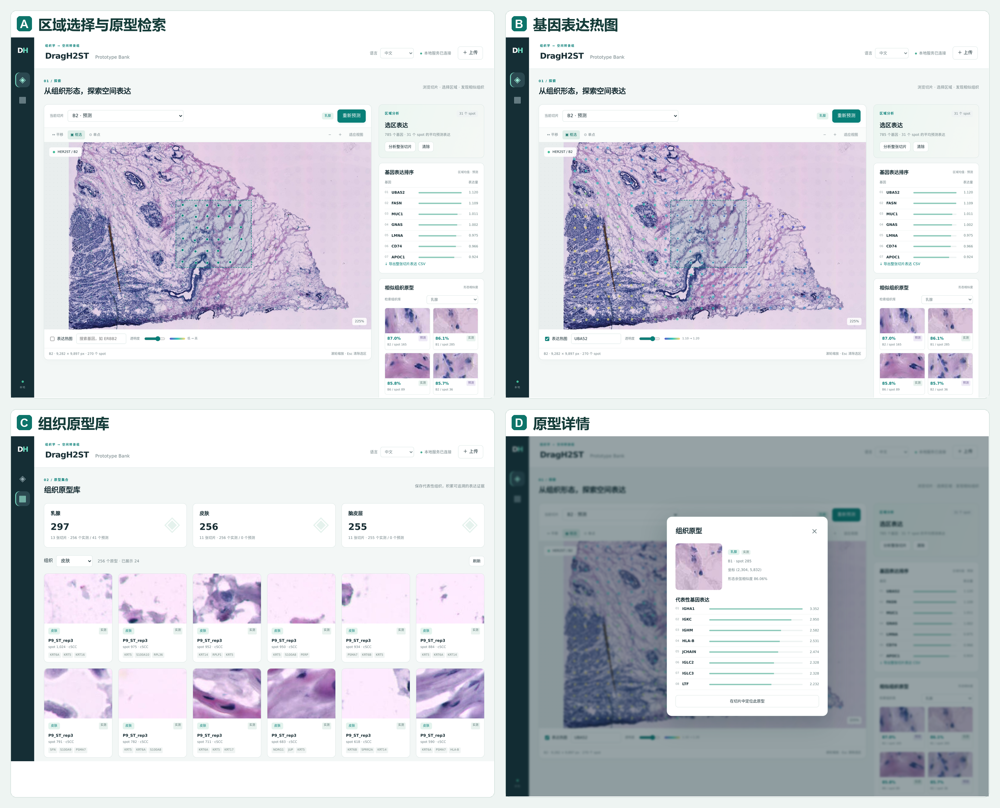

# DragH2ST

[English](../README.md) | [简体中文](README.zh-CN.md)

**用于组织图像到空间转录组预测的动态调控图学习方法**

DragH2ST 结合组织形态、空间上下文与生物知识，从 H&E 病理图像预测空间基因表达。
方法融合多源知识构建任务相关的基因先验，并通过组织学上下文门控，使共享基因表示
适应各个 spot 的局部微环境。模型联合视觉预测与调控预测，捕捉空间表达模式，
同时检索形态相似的组织原型，为预测结果提供案例参照。


*图 1：DragH2ST 整体框架。*

## 安装

推荐使用 Python 3.10、PyTorch 2.4.1 和 CUDA 12.4，并在 NVIDIA GPU 上运行。

```bash
python3.10 -m venv .venv
source .venv/bin/activate
python -m pip install --upgrade pip
python -m pip install torch==2.4.1 torchvision==0.19.1 --index-url https://download.pytorch.org/whl/cu124
python -m pip install -r requirements.txt
```

## 配置与资源位置

**所有参数和路径只修改 `config.yaml`。** 命令行只接受操作名称，相对路径以项目目录为基准。
默认路径为：

```yaml
paths:
  data: data
  artifacts: artifacts
  resnet_weights: data/weights/resnet50-11ad3fa6.pth
```

| 资源                      | 位置                                     | 获取方式                                                     |
| ------------------------- | ---------------------------------------- | ------------------------------------------------------------ |
| 整理后的数据集            | `data/{her2st,cSCC,dlpfc}/`            | 单独获取并按下方目录整理                                     |
| 原始生物先验资源          | `data/biological_database/`            | 将随包提供的`data/biological_database.7z` 解压到 `data/` |
| ResNet50 ImageNet V2 权重 | `data/weights/resnet50-11ad3fa6.pth`   | 使用下方命令手动下载                                         |
| ResNet 图像特征缓存       | `artifacts/features/`                  | 由`prepare` 或 `train` 生成                              |
| 融合先验矩阵与基因嵌入    | `artifacts/priors/`                    | 根据本地生物资源自动构建                                     |
| 训练模型与评估结果        | `artifacts/runs/<dataset>/fold<fold>/` | 由训练和评估生成                                             |
| 持久化 Prototype Bank     | `artifacts/library/prototypes.sqlite3` | 由`build-library` 和网页添加操作生成                       |
| 上传文件与网页预测缓存    | `artifacts/workspace/`                 | 由 Prototype Bank 工作区生成                                 |

当前包中包含 `data/biological_database.7z`，以及预留的数据集和权重目录。
按下文步骤解压知识库、准备数据集与 ResNet 权重，运行产物会在本地生成。

## 数据集

我们在 HER2ST、cSCC 和 DLPFC 三个数据集上开展实验，相关论文和访问链接见
[资源与引用](#资源与引用)。数据读取器要求以下目录结构：

```text
data/
├── biological_database.7z            # 随包提供，解压到 data/
├── weights/resnet50-11ad3fa6.pth      # 单独下载官方权重
├── her_hvg_cut_1000.npy               # 有序列表：785 个 HER2ST 基因
├── cSCC_hvg_cut_1000.npy              # 有序列表：1000 个 cSCC 基因
├── dlpfc_hvg_cut_1000.npy             # 有序列表：1000 个 DLPFC 基因
├── her2st/data/
│   ├── ST-cnts/<slide>.tsv
│   ├── ST-spotfiles/<slide>_selection.tsv
│   └── ST-imgs/<group>/<slide>/<image>
├── cSCC/GSE144239_RAW/
│   ├── *_<slide>_stdata.tsv[.gz]
│   ├── *spot_data-selection-<slide>.tsv[.gz]
│   └── *_<slide>.jpg[.gz]
├── dlpfc/<slide>/
│   ├── <slide>_filtered_feature_bc_matrix.h5
│   ├── tissue_positions_list.txt
│   ├── scalefactors_json.json
│   └── <slide>_full_image.tif
└── biological_database/
    ├── gene2vec_dim_200_iter_9_w2v.txt
    ├── go-basic.obo
    ├── goa_human.gaf
    ├── c2.cp.v2025.1.Hs.symbols.gmt
    └── string/
        ├── 9606.protein.links.v12.0.txt
        ├── 9606.protein.info.v12.0.txt
        └── gene2protein_symbol_to_ensp.tsv
```

`[.gz]` 表示 cSCC 文件可以带 gzip 后缀。当前实现使用 HER2ST 的 A1–A6/B1–B6、
cSCC 的 P2/P5/P9/P10 各三次重复，以及 `drag_h2st/data.py` 中列出的 12 张 DLPFC 切片。

`training.dataset` 和 `training.fold` 指定本次训练的数据集和折，折编号从 0 开始。
`datasets.folds` 指定特征准备与 Prototype Bank 中各组织使用的模型及训练划分。
更换训练折时，应同步修改其中对应数据集的折编号。

## 生物先验

DP-RAG 融合 Gene2Vec 余弦相似度、MSigDB 基因集成员相似度、STRING 互作及共享邻居
相似度、GO 语义相似度。四种资源的权重、融合相似度阈值和图 Top-K 均在
`config.yaml` 中设置。

随包提供的 `data/biological_database.7z` 包含来自 [Gene2Vec](https://github.com/jingcheng-du/Gene2vec)、
[GO 与 GOA](https://geneontology.org/)、[STRING v12](https://string-db.org/)，
以及 [MSigDB](https://www.gsea-msigdb.org/gsea/msigdb/human/collections.jsp) 中的
**人类 C2 canonical pathways、2025.1、gene symbols** 集合所需的资源文件。
`gene2protein_symbol_to_ensp.tsv` 基因到蛋白映射也已包含。
压缩包约 **82.2 MiB**，包含 7 个文件，解压后合计约 **885.0 MiB**。
首次运行 `prepare` 或 `train` 前，在项目根目录使用 [7-Zip](https://www.7-zip.org/) 解压：

```bash
7z x data/biological_database.7z -odata
```

使用 7-Zip 图形界面时，将解压目标目录选为 `data/`。
压缩包内部已带有 `biological_database/` 文件夹，解压后应得到上方列出的
`data/biological_database/` 结构，程序会读取其中的文件。
若修改了 `paths.data`，请解压到对应的数据目录。

`prepare` 根据本地文件构建融合相似度和基因嵌入，并缓存到 `artifacts/priors/`。
训练时也会构建缺失的先验，已有且兼容的缓存会直接复用。

## ResNet 权重

图像编码器使用冻结的 torchvision 官方 **ResNet50 ImageNet V2** 权重。
首次提取特征前，请手动下载指定文件：

```bash
mkdir -p data/weights
curl -fL --retry 3 https://download.pytorch.org/models/resnet50-11ad3fa6.pth -o data/weights/resnet50-11ad3fa6.pth
```

加载器会校验文件是否为预期的官方权重。如放在其他目录，请修改
`paths.resnet_weights`。图像特征提取使用 112 × 112 的组织裁剪，缩放至
224 × 224 后进行 ImageNet 标准化。

## 运行

```bash
python run.py prepare       # 准备三个数据集的图像特征和生物先验
python run.py train         # 训练 config.yaml 指定的数据集和折
python run.py evaluate      # 评估该折保存的最佳 checkpoint
python run.py build-library # 构建包含实测表达的 Prototype Bank
python run.py serve         # 启动 Prototype Bank 网页工作区
python run.py search        # 围绕当前 YAML 进行小范围参数搜索
```

完整工作区的使用顺序为：`prepare` → 训练所需数据集和折 → `build-library` → `serve`。
如需三个组织的模型，依次修改同一份 YAML 并训练各数据集的指定折。
单独运行 `train` 时，会自动准备当前划分缺失的图像特征。

默认配置为 HER2ST fold 0、seed 12000、最多 500 个 epoch，早停 patience=50。
按 **HVG50 PCC + HEG50 PCC** 选择最佳 checkpoint，推理加载该最佳模型。
checkpoint 保存训练配置和有序基因列表。

`datasets.folds` 中三个数据集的示例折编号均设为 0，可按运行需要手动修改。

`search` 使用正常的完整训练预算，测试十个邻近单参数候选，再组合最多三组有收益的设置。
按同一验证指标选择结果，完全同分时依次比较全基因 PCC 和更低的 MSE。
实验记录保存在 `artifacts/search/`，原始配置和模型会备份，选中的配置与模型会自动应用。
由于同一留出切片参与 epoch 和参数选择，这些分数属于验证结果；泛化效果需要独立测试划分。

## Prototype Bank

运行 `python run.py serve` 后，访问 **http://localhost:8080**。
主机和端口在 `config.yaml` 中设置，远程访问时可转发 8080 端口。前端资源均在本地提供。
语言选择器支持**英文、法文、西班牙文和中文，首次打开默认英文**，并在当前浏览器中记住选择。
界面文字、组织标签、对话框、任务状态、校验提示和数字格式会同步切换；
用户自定义组织名称及科学标识保留原值。

1. 选择内置切片，或上传 PNG/JPEG/TIFF 并指定组织模型。可选 CSV 提供
   `pixel_x,pixel_y` 和网格 `x,y`；未提供时自动进行组织采样。
2. 预测表达，缩放、平移图像，框选区域或选择单个 spot。
3. 查看区域平均表达排序、基因热图和形态相似的组织原型。
4. 查看原型图像、表达来源和切片位置，将预测切片加入组织库，或导出整张切片的表达 CSV。

实测原型库在标准化 ResNet 特征空间中进行 K-Means，选择最接近聚类中心的真实 spot，
每个数据集的训练划分预算为 256 个原型，不包含留出切片的实测表达。
网页添加的原型明确标记为预测来源，重复添加会替换该切片已有原型。
检索采用余弦相似度，要求组织一致且基因列表及其顺序完全一致。
原型表达用于展示证据，不参与模型预测融合。

[](screenshots/prototype-bank-overview-zh.png)

*原型库工作区：（A）区域选择与检索，（B）基因表达热图，（C）组织原型库，（D）原型详情。点击图片可放大查看。*

## 代码结构与方法约定

```text
DragH2ST/
├── LICENSE
├── README.md
├── requirements.txt
├── config.yaml
├── run.py
├── assets/
│   ├── README.zh-CN.md
│   ├── figure1.png
│   └── screenshots/         # 原型库界面截图（中英文）
├── data/
│   ├── biological_database.7z
│   ├── her2st/data/           # 预留的数据集空目录
│   │   ├── ST-cnts/
│   │   ├── ST-imgs/
│   │   └── ST-spotfiles/
│   ├── cSCC/GSE144239_RAW/
│   ├── dlpfc/
│   └── weights/              # 将下载的 ResNet 权重放在这里
└── drag_h2st/
    ├── config.py
    ├── data.py
    ├── features.py
    ├── attention.py
    ├── spatial_encoder.py
    ├── dp_rag/
    ├── cgdr.py
    ├── model.py
    ├── losses.py
    ├── metrics.py
    ├── pipeline.py
    ├── search.py
    └── prototype_bank/
        ├── bank.py
        ├── workspace.py
        ├── server.py
        ├── messages.py
        └── static/
            ├── index.html
            ├── style.css
            ├── i18n.js
            ├── translations.json
            └── app.js
```

| 论文模块                      | 代码                                                      |
| ----------------------------- | --------------------------------------------------------- |
| Spatial Encoder / Spatial GCN | `features.py`、`spatial_encoder.py`、`attention.py` |
| DP-RAG                        | `dp_rag/`                                               |
| CGDR / Gene GAT               | `cgdr.py`                                               |
| Synergistic Prediction        | `model.py`                                              |
| 优化目标                      | `losses.py`                                             |
| Prototype Bank                | `prototype_bank/`                                       |

表达预处理先进行 library-size normalization，再使用 `scprep.transform.log`
的实际默认变换 **log10(x+1)**。空间图为距离 ≤2 的有向四邻居图。
CGDR 在共享 Gene GAT 之后进行上下文门控，最终预测采用线性分支和调控分支的加权融合，
遵循主 ResNet 实现。训练在特征准备完成后重新设置随机种子。

## 致谢

本工作的部分思想受到 [Hist2ST（Zeng 等，2022）](https://doi.org/10.1093/bib/bbac297)、
[M2TGLGO（Shi 等，CVPR 2025）](https://doi.org/10.1109/CVPR52734.2025.01938) 和
[STRank（Nishimura 等，2025）](https://arxiv.org/abs/2512.06612) 的启发。
感谢相关作者分享研究成果与资源，也感谢 ResNet 的作者、torchvision 的维护者，
以及本研究所使用的数据集和生物数据库的贡献者。

## 资源与引用

以下汇总了本研究使用的数据集、生物资源和视觉骨干模型，并列出对应论文及资源链接。

| 资源 | 相关论文 | 访问链接 |
| --- | --- | --- |
| ResNet50 / ImageNet V2 权重 | [Deep Residual Learning for Image Recognition](https://doi.org/10.1109/CVPR.2016.90)，CVPR，2016 | [权重下载](https://download.pytorch.org/models/resnet50-11ad3fa6.pth) / [torchvision 文档](https://pytorch.org/vision/stable/models/generated/torchvision.models.resnet50.html) |
| HER2ST | [Spatial deconvolution of HER2-positive breast cancer delineates tumor-associated cell type interactions](https://doi.org/10.1038/s41467-021-26271-2)，Nature Communications，2021 | [数据集](https://github.com/almaan/her2st) |
| cSCC | [Multimodal Analysis of Composition and Spatial Architecture in Human Squamous Cell Carcinoma](https://doi.org/10.1016/j.cell.2020.05.039)，Cell，2020 | [GEO：GSE144239](https://www.ncbi.nlm.nih.gov/geo/query/acc.cgi?acc=GSE144239) |
| DLPFC | [Transcriptome-scale spatial gene expression in the human dorsolateral prefrontal cortex](https://doi.org/10.1038/s41593-020-00787-0)，Nature Neuroscience，2021 | [spatialLIBD](https://research.libd.org/spatialLIBD/) |
| Gene2Vec | [Gene2vec: distributed representation of genes based on co-expression](https://doi.org/10.1186/s12864-018-5370-x)，BMC Genomics，2019 | [Gene2Vec 资源](https://github.com/jingcheng-du/Gene2vec) |
| GO / GOA | [The Gene Ontology knowledgebase in 2023](https://doi.org/10.1093/genetics/iyad031)，Genetics，2023 | [Gene Ontology](https://geneontology.org/) / [GOA](https://www.ebi.ac.uk/GOA) |
| STRING v12 | [The STRING database in 2023: protein-protein association networks and functional enrichment analyses for any sequenced genome of interest](https://doi.org/10.1093/nar/gkac1000)，Nucleic Acids Research，2023 | [STRING 下载页](https://string-db.org/cgi/download) |
| MSigDB C2 canonical pathways | [Molecular signatures database (MSigDB) 3.0](https://doi.org/10.1093/bioinformatics/btr260)，Bioinformatics，2011；[Gene set enrichment analysis: A knowledge-based approach for interpreting genome-wide expression profiles](https://doi.org/10.1073/pnas.0506580102)，PNAS，2005 | [人类基因集](https://www.gsea-msigdb.org/gsea/msigdb/human/collections.jsp) |

